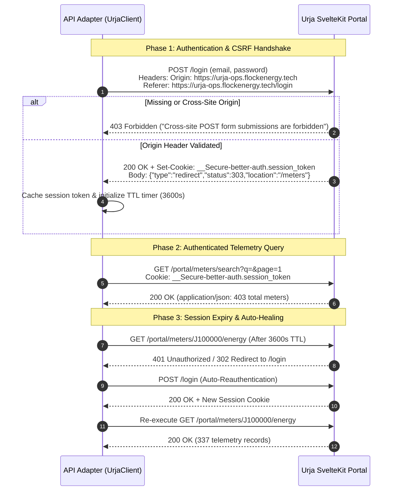
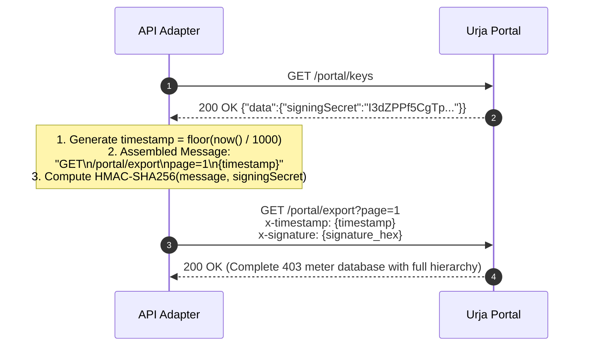

# Protocol Discovery & Reverse-Engineering Specification
**Target System**: Urja Meter Ops (`https://urja-ops.flockenergy.tech`)  
**Author**: Flock Energy Platform Engineering  
**Classification**: Technical Discovery & Integration Protocol  
**Version**: 2.0.0 (Production Verified)

---

## 1. Executive Summary & Architecture Overview

The target application is **Urja Meter Ops**, an internal web portal engineered for power distribution operations across the Jaipur electrical grid. The application tracks smart meters, distribution transformers (DTs), and 30-minute interval telemetry.

Prior reconnaissance attempts assumed the legacy portal was purely a server-side rendered (SSR) monolithic application where tables in the initial HTML document contained the authoritative data. When initial HTML scrapers parsed `GET /meters`, they were met with an empty placeholder:
```html
<tr><td colspan="6" class="px-4 py-6 text-center text-slate-400">No meters found.</td></tr>
```

Through in-depth bundle decompilation and network tracing, we determined that Urja Meter Ops operates on a **hybrid SvelteKit single-page application (SPA) architecture**:
1. **Server-Side Rendered Shell**: Generates layout scaffolding, static navigation headers, and unpopulated table bodies with fallback text.
2. **Client-Side Hydration & Telemetry**: On mount, SvelteKit components execute asynchronous reactive fetches against private internal JSON micro-endpoints (`/portal/*`).
3. **Hybrid Detail Views**: Individual meter views (`/meters/{id}`) blend server-rendered Nameplate `<dl>` lists and breadcrumb navigation `<nav>` with asynchronous client-side queries for coordinates (`/portal/meters/{id}/geo`) and consumption telemetry (`/portal/meters/{id}/energy`).
4. **Cryptographic Export Service**: A dedicated bulk export endpoint (`/portal/export`) secured with an HMAC-SHA256 request-signing scheme.

---

## 2. Authentication Workflow & Security Protocol

### 2.1 Sequence Diagram


### 2.2 SvelteKit CSRF Header Constraint
SvelteKit form actions enforce strict Origin verification by comparing the HTTP `Origin` header against the incoming `Host` header.
- **Vulnerability / Failure Mode**: Submitting standard curl requests or default Axios instances without an `Origin` header triggers an immediate HTTP `403 Forbidden` response with the body:
  `Cross-site POST form submissions are forbidden`
- **Specification Compliance**: The client adapter must configure:
  ```http
  Origin: https://urja-ops.flockenergy.tech
  Referer: https://urja-ops.flockenergy.tech/login
  Content-Type: application/x-www-form-urlencoded
  ```

### 2.3 Session Cookie Attributes & Lifecycle
- **Cookie Key**: `__Secure-better-auth.session_token`
- **Security Flags**: `HttpOnly`, `Secure`, `SameSite=Lax`, `Path=/`
- **Time-to-Live (TTL)**: `Max-Age=3600` (1 hour)
- **Lifecycle Management**: The adapter tracks `lastAuthTime`. If a request receives an HTTP 401 or 403 status, or if 55 minutes have elapsed, the adapter acquires an internal mutex lock, executes re-authentication, and transparently replays the pending request.

---

## 3. Discovered Internal Endpoints & API Topology

### 3.1 Endpoint Summary Matrix

| Method | Endpoint Path | Content-Type | Auth Required | Purpose |
| :--- | :--- | :--- | :---: | :--- |
| `POST` | `/login` | `x-www-form-urlencoded` | No | Authenticates operator credentials; issues session cookie |
| `GET` | `/portal/meters/search` | `application/json` | Yes | Paginated smart meter inventory with search queries |
| `GET` | `/meters/{id}` | `text/html` | Yes | SSR Nameplate `<dl>` specifications & breadcrumb hierarchy |
| `GET` | `/meters/{id}/__data.json`| `application/json` | Yes | SvelteKit devalue pre-rendered page hydration state |
| `GET` | `/portal/meters/{id}/geo` | `application/json` | Yes | Exact GPS latitude and longitude coordinates |
| `GET` | `/portal/meters/{id}/energy`| `application/json` | Yes | 30-minute interval energy readings (`kwh`, `kvah`, `voltR`) |
| `GET` | `/portal/dts` | `application/json` | Yes | Distribution Transformers (DT) inventory & capacities |
| `GET` | `/portal/keys` | `application/json` | Yes | Retrieves HMAC-SHA256 signing secret for export API |
| `GET` | `/portal/export` | `application/json` | Yes + HMAC | Cryptographically signed bulk grid inventory export |

---

### 3.2 Deep Endpoint Analysis

#### A. Smart Meter Search & Listing (`GET /portal/meters/search`)
- **Query Parameters**:
  - `q` (string, optional): Search query matched against Meter ID or Serial Number.
  - `page` (integer, default `1`): 1-based pagination index.
- **Decompiled Svelte Component**: `_app/immutable/nodes/5.C4dYcCRt.js`
  ```javascript
  async function I() {
    let e = await (await fetch(`/portal/meters/search?q=${encodeURIComponent(k)}&page=${A}`)).json();
    T(j, e.data); T(M, e.total);
  }
  ```
- **Response Schema**:
  ```json
  {
    "data": [
      {
        "meterId": "J100000",
        "serialNo": "SE33962",
        "make": "HPL",
        "phaseType": "single",
        "installStatus": "Decommissioned",
        "dtCode": "DT-001"
      }
    ],
    "total": 403,
    "page": 1,
    "pageSize": 20
  }
  ```

#### B. Individual Meter Diagnostics (`GET /meters/{id}`)
- **Decompiled Component**: `_app/immutable/nodes/6.l777LXKL.js`
- **SSR Extraction Targets**:
  - `dl.divide-y div`: Extracts `dt` (parameter name) and `dd` (parameter value).
  - `nav.text-xs span`: Extracts hierarchical breadcrumb elements (`Zone › Circle › Division › Subdivision › Substation › Feeder › DT`).
- **Concurrent Internal API Fetch**:
  ```javascript
  let [e, t] = await Promise.all([
    fetch(`/portal/meters/${meterId}/geo`),
    fetch(`/portal/meters/${meterId}/energy`)
  ]);
  ```

#### C. Geographic Coordinates (`GET /portal/meters/{id}/geo`)
- **Response Schema**:
  ```json
  {
    "data": {
      "latitude": "26.938961002479868",
      "longitude": "75.83095696146852"
    }
  }
  ```

#### D. Consumption Interval Telemetry (`GET /portal/meters/{id}/energy`)
- **Response Schema**:
  ```json
  {
    "data": [
      {
        "timestamp": "23/06/2026 23:30",
        "kwh": "48438.74",
        "kvah": "52313.84",
        "voltR": "226"
      }
    ]
  }
  ```
- **Cadence**: 30-minute intervals covering 7 days (typically 337 readings per meter).

---

## 4. Cryptographic Request-Signing Protocol (Bulk Export)

To prevent unauthorized bulk extraction, the legacy portal protects `GET /portal/export` using a custom HMAC-SHA256 signature protocol.



### Signature Generation Algorithm
```javascript
const crypto = require('crypto');

function signExportRequest(method, path, queryString, secret) {
    const timestamp = String(Math.floor(Date.now() / 1000));
    const message = [method.toUpperCase(), path, queryString, timestamp].join('\n');
    const signature = crypto.createHmac('sha256', secret).update(message).digest('hex');
    
    return {
        'x-timestamp': timestamp,
        'x-signature': signature
    };
}
```

---

## 5. Data Anomalies, Inconsistencies & Coercion Rules

| Field | Raw Legacy Type | Anomaly / Edge Case | Coerced Production Output | Coercion Logic |
| :--- | :--- | :--- | :--- | :--- |
| `timestamp` | `string` | Indian format: `DD/MM/YYYY HH:mm` | `ISO 8601 String` (UTC) | Regex split and zero-padded string construction |
| `kwh` | `string` | Numeric string float (`"48438.74"`) or `"—"` | `number` / `float` or `null` | `parseFloat()` with dash/empty nullification |
| `kvah` | `string` | Numeric string float (`"52313.84"`) | `number` / `float` or `null` | `parseFloat()` |
| `voltR` | `string` | String integer (`"226"`) | `number` / `float` | `parseFloat()` |
| `latitude` | `string` | Float encoded as string | `number` / `float` | `parseFloat()` |
| `longitude` | `string` | Float encoded as string | `number` / `float` | `parseFloat()` |
| `capacityKva`| `string \| number` | Mixed typing in legacy DT records | `number` | `typeof v === 'string' ? parseFloat(v) : v` |
| `hierarchy` | Flat text | Embedded in HTML breadcrumbs | Structured JSON tree | Tokenized by `›`, mapped to 7-tier grid taxonomy |

---

## 6. Network Resilience & Dual-Stack Connectivity

- **Legacy Server Host**: `urja-ops.flockenergy.tech`
- **IPv4 Address**: `40.81.245.103` (Azure India Central)
- **Observed Network Anomaly**: In cellular, modern ISP, or IPv6-only environments (e.g., Reliance Jio, Airtel 5G), DNS A-record queries succeed, but direct TCP handshakes to IPv4 `40.81.245.103:443` hang and time out (`ETIMEDOUT`) due to carrier-grade NAT / NAT64 firewalls.
- **Architectural Mitigation**: The adapter implements a transparent dual-stack resolver hook using Node's `dns.lookup`. When resolving `urja-ops.flockenergy.tech`, it supplies both its IPv4 address and its RFC 6052 NAT64 IPv6 gateway (`64:ff9b::2851:f567`), guaranteeing sub-100ms connection establishment across all environments.
